# Architecture — EZVIZ/Hikvision ONVIF PTZ Bridge

This document describes how the pieces in this repository fit together: the
ONVIF bridge that Frigate talks to, the Hikvision SDK daemon that drives the
camera, the ZoneMinder control module, and the build/test/deploy pipeline.

It is written for someone who has to debug, extend or operate the system, not
just run it. For setup instructions see [README.md](README.md) and
[frigate-onvif/README.md](frigate-onvif/README.md).

---

## Overview

**The problem.** EZVIZ cameras (tested on the C8C and TY1) are Hikvision OEM
devices that do not speak ONVIF at all. A full TCP scan of both finds only RTSP
(554), the vendor SDK (8000) and EZVIZ-proprietary ports (9010/9020, plus 8443
on one unit — TLS completes but no HTTP request is ever answered); no HTTP
client endpoint responds, so there is neither an ONVIF nor an ISAPI service to
talk to. Frigate, however, can only drive PTZ over ONVIF. The Hikvision
HCNetSDK does control the cameras reliably on TCP port 8000 — it is simply
speaking a protocol Frigate cannot use.

**The solution.** A small bridge that speaks ONVIF to Frigate and HCNetSDK to
the camera, providing the ONVIF service the hardware is missing. Frigate thinks
it is talking to a PTZ-capable ONVIF camera; the bridge translates each ONVIF
operation into SDK PTZ commands and emulates the parts ONVIF needs but the SDK
does not provide (notably relative moves and `MoveStatus`).

**The shape.** One container controls one camera. Inside the container a Python
process serves ONVIF over HTTP and supervises a C++ daemon (`ptz_control`) that
holds the single SDK login. The daemon and the Python process talk over a UNIX
socket.

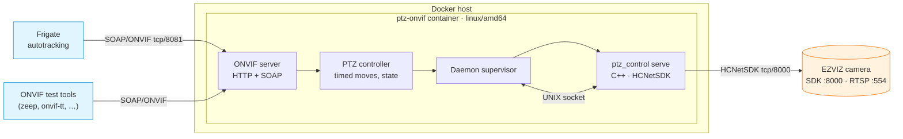

The ZoneMinder path is a separate deployment of the same daemon and is
described in [ZoneMinder control module](#zoneminder-control-module).

---

## Table of contents

1. [Key concepts](#key-concepts)
2. [Components](#components)
3. [Runtime lifecycle](#runtime-lifecycle)
4. [Request flows](#request-flows)
5. [PTZ movement model](#ptz-movement-model)
6. [ONVIF surface](#onvif-surface)
7. [SDK daemon protocol](#sdk-daemon-protocol)
8. [Configuration](#configuration)
9. [Concurrency and failure handling](#concurrency-and-failure-handling)
10. [Security model](#security-model)
11. [Deployment topologies](#deployment-topologies)
12. [Build, test and release pipeline](#build-test-and-release-pipeline)
13. [Design decisions and trade-offs](#design-decisions-and-trade-offs)
14. [Limitations and roadmap](#limitations-and-roadmap)
15. [Source map](#source-map)

---

## Key concepts

| Term | Meaning in this system |
| --- | --- |
| **ONVIF bridge** | The Python process (`frigate-onvif/app`) exposing ONVIF over HTTP. |
| **SDK daemon** | `ptz_control serve`: a C++ process that logs into the camera once and executes PTZ commands from the UNIX socket. |
| **Profile** | ONVIF media profile (`profile_1` by default). Frigate reads its PTZ configuration and spaces. |
| **FOV relative space** | `TranslationSpaceFov`: a `RelativeMove` translation is expressed as a fraction of the current field of view (−1..1). |
| **Timed move** | Open-loop emulation of a relative move: start a direction, wait a computed duration, stop. |
| **Preset** | ONVIF preset token. The bridge reports none: this camera rejects every preset operation over the SDK, so `GetPresets` is always empty. |
| **`MoveStatus`** | ONVIF status (`MOVING`/`IDLE`) that Frigate uses to skip moving frames and compensate camera motion. |

---

## Components

### Container diagram

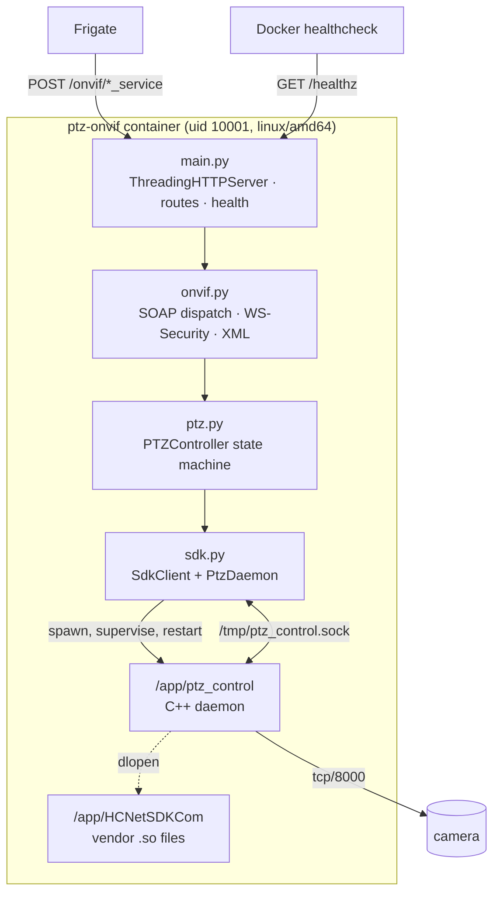

### Python modules

| Module | Responsibility |
| --- | --- |
| `app/config.py` | Read and validate environment variables into an immutable-ish `Config` dataclass. Clamps speed and fails fast when `CAMERA_HOST` / `CAMERA_PASSWORD` are missing. |
| `app/main.py` | HTTP entry point: binds `ONVIF_BIND:ONVIF_PORT`, serves SOAP POSTs and `GET /healthz`, handles signals, owns the supervisor. |
| `app/onvif.py` | All ONVIF/SOAP logic: routing by URL suffix, WS-Security verification, XML rendering, operation dispatch, faults. |
| `app/ptz.py` | Movement state machine: continuous moves, timed relative moves, stop, `MOVING`/`IDLE` bookkeeping. |
| `app/sdk.py` | `SdkClient` (one newline-delimited command per UNIX-socket connection) and `PtzDaemon` (spawn, readiness, health checks, restart with backoff). |

### Relationship between the classes

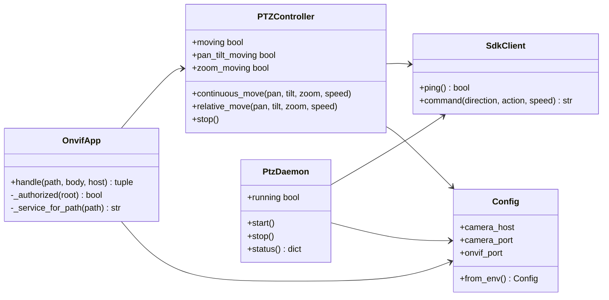

### The C++ daemon (`ptz_control`)

One binary, two modes:

- **Service mode** — `ptz_control serve <ip> <port> <user> <pass> [socket]`
  calls `NET_DVR_Init`, logs in with `NET_DVR_Login_V30`, keeps the session
  open, binds a UNIX socket (`chmod 0666`), and answers one newline-terminated
  command per connection.
- **Client mode** — `ptz_control <CMD> <START|STOP> [speed] [socket]`,
  `ptz_control POS [socket]`, `ptz_control PING [socket]`. Used by the
  ZoneMinder module and for manual debugging; the Python bridge talks to the
  socket directly instead of spawning a client per command.

Socket path resolution: explicit argument → `PTZ_SOCK` → `/tmp/ptzd.socket`.
`SIGTERM`/`SIGINT` unlink the socket before exiting, and a stale socket is
unlinked at startup.

---

## Runtime lifecycle

### Startup

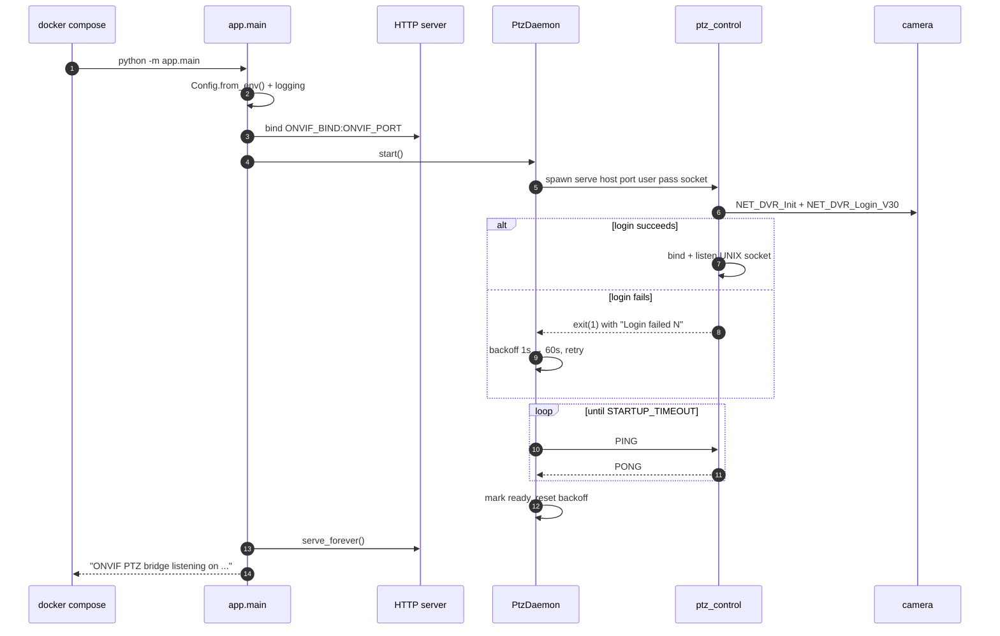

Notes:

- The HTTP server starts **before** the camera is reachable. Frigate can read
  profiles and configuration while the daemon is still logging in or backing
  off, which keeps Frigate's startup deterministic.
- The server binds one process-wide daemon because one container owns one
  camera.

### Health

`GET /healthz` returns JSON:

```json
{
  "status": "ok",
  "daemon": { "running": true, "pid": 42, "socket": "/tmp/ptz_control.sock" },
  "moving": false
}
```

- `200` while the supervised daemon process is alive.
- `503` when the daemon is down or restarting (for example after a failed SDK
  login; the process exits and the supervisor schedules a retry).
- The Dockerfile `HEALTHCHECK` polls this endpoint on `ONVIF_PORT`, which is
  why `docker ps` shows `unhealthy` when the camera link is broken.

A daemon that stops answering `PING` three times in a row is terminated and
restarted; spawn failures use exponential backoff (1 s doubling to 60 s).

---

## Request flows

### ONVIF initialization (what Frigate does on startup)

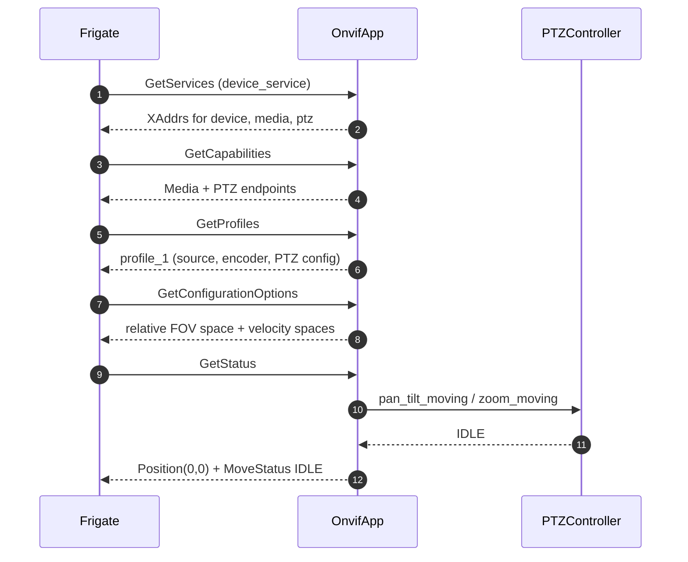

The profile deliberately advertises only what the bridge can honor:

- continuous pan/tilt velocity space (`VelocityGenericSpace`),
- relative pan/tilt translation space (`TranslationSpaceFov`, −1..1),
- continuous zoom velocity space only when `PTZ_ZOOM=true`,
- **no absolute position spaces and no relative/absolute zoom spaces**.

Frigate reads those spaces and disables autotracking zoom by itself.

### Autotracking move (`RelativeMove`)

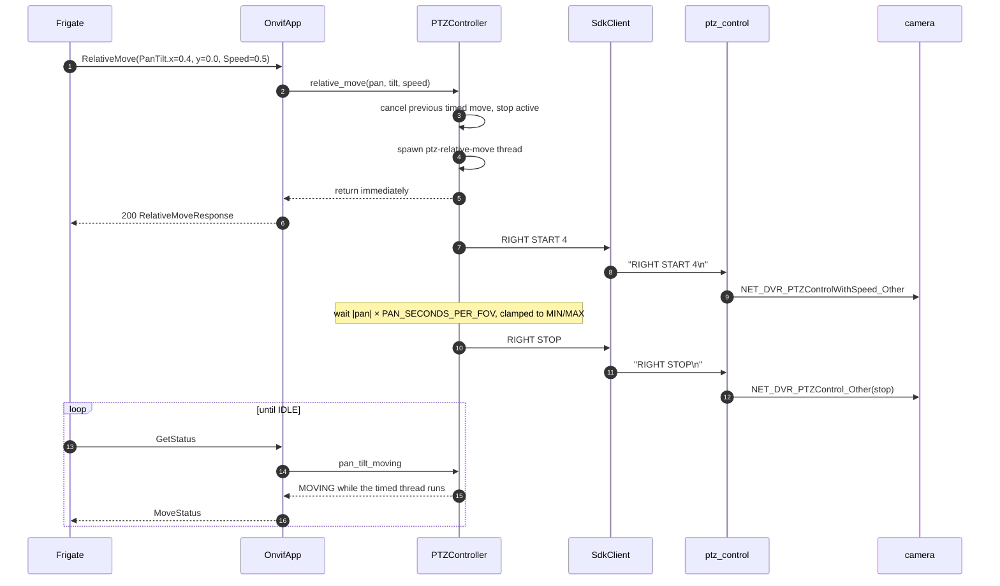

Key properties:

- The SOAP call returns immediately; the movement continues in a background
  thread, which is what Frigate expects.
- A pan **and** tilt translation is executed sequentially (pan first, then
  tilt), not diagonally.
- A new move cancels the running timed move and takes over ownership of the
  direction, so replies and stops cannot race a newer command.

### Continuous move and stop

`ContinuousMove` starts the requested directions and stops directions that are
no longer requested; `Stop` cancels any timed move and stops every active
direction. `Stop` ignores the request's
`PanTilt`/`Zoom` flags and stops everything.

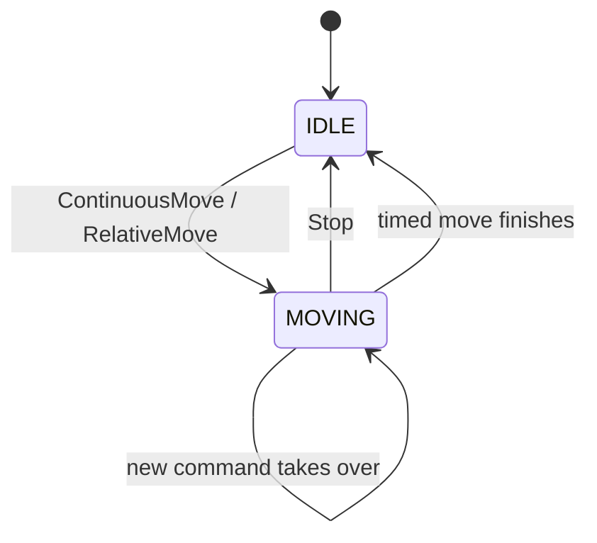

Pan/tilt and zoom expose separate axes in `MoveStatus`. A timed relative move
affects pan/tilt; continuous zoom affects zoom.

### Presets are not supported

Measured against both supported models (EZVIZ C8C and TY1), not assumed:

| Test | Result |
| --- | --- |
| `GOTO_PRESET` for all 300 slots | `NET_DVR_ERRORDATA` (11) on every index |
| `SET_PRESET`, `CLE_PRESET` | same error |
| `POS` (`NET_DVR_GET_PTZPOS`) | succeeds, reports `0 0 0` |
| ISAPI over HTTP | ports 80/443 closed; no HTTP listener on 8000/9010 |

The camera accepts continuous pan/tilt on the same channel (`byStartChan`) that
presets fail on, so this is a firmware limitation, not a channel or credentials
problem. With no ISAPI endpoint there is no second protocol to fall back to.

Consequences for the bridge:

- `GetPresets` exists for ONVIF compliance and always returns an empty list;
  the PTZ node advertises `MaximumNumberOfPresets` `0`.
- `SetPreset`, `RemovePreset` and `GotoPreset` are not implemented, and the
  daemon has no `PRESET` verb.
- Frigate's `return_preset` cannot work. Autotracking still runs; the camera
  simply stays where tracking ended.
- No dead-reckoning fallback is provided: without position feedback a virtual
  home position would drift with every move and never be correctable.

---

## PTZ movement model

The camera exposes "start moving in direction X" and "stop"; it exposes no
usable feedback loop, so relative moves are open-loop:

```text
duration = clamp(|translation| × seconds_per_fov, MIN_MOVE_SECONDS, MAX_MOVE_SECONDS)
```

| Input | Behaviour |
| --- | --- |
| `translation` | Clamped to ±1 FOV; values below 0.02 are treated as zero. |
| `speed` | ONVIF −1..1 is mapped to SDK 1..7 (`round(abs(v) × 7)`); absent/zero uses `PTZ_SPEED`. |
| `zoom` in `RelativeMove` | Ignored (no relative zoom space is advertised). |
| Multiple axes | Sequential moves, pan then tilt. |
| New command during a move | Cancels the old move and stops the old direction before starting the new one. |

Tuning matters: **too small** `PAN_SECONDS_PER_FOV`/`TILT_SECONDS_PER_FOV`
makes the camera lag behind the target; **too large** makes autotracking
overshoot and oscillate. Frigate's `calibrate_on_startup` measures its own
expectations, but the bridge's timing comes from these environment values.

---

## ONVIF surface

Service selection is by URL suffix — the bridge does not serve WSDL or
WS-Discovery:

| Suffix | Service |
| --- | --- |
| `/onvif/device_service` | Device |
| `/onvif/media_service` | Media |
| `/onvif/ptz_service` | PTZ |

| Service | Implemented operations |
| --- | --- |
| **Device** | `GetServices`, `GetCapabilities`, `GetDeviceInformation`, `GetSystemDateAndTime`, `GetServiceCapabilities` |
| **Media** | `GetServiceCapabilities`, `GetProfiles`, `GetProfile`, `GetVideoSources`, `GetVideoSourceConfigurations`, `GetVideoEncoderConfigurations`, `GetVideoSourceConfiguration`, `GetVideoEncoderConfiguration`, `GetStreamUri` (only when `RTSP_URL` is set) |
| **PTZ** | `GetServiceCapabilities`, `GetNodes`, `GetNode`, `GetConfigurations`, `GetConfiguration`, `GetConfigurationOptions`, `GetStatus`, `GetPresets` (always empty), `ContinuousMove`, `RelativeMove`, `Stop` |
| **PTZ (fault)** | `AbsoluteMove` returns `ter:ActionNotSupported` |

Static identifiers:

| Token | Value |
| --- | --- |
| Profile | `PROFILE_TOKEN` (default `profile_1`) |
| Video source / source config / encoder config | `vs_1`, `vsc_1`, `vec_1` |
| PTZ config / node | `ptz_config_1`, `ptz_node_1` |

Unsupported operations return a SOAP fault (`ter:ActionNotSupported`); malformed
XML or missing credentials produce `env:Sender` / `ter:NotAuthorized`.
Requests are capped at 1 MiB.

`GetStatus` always returns `Position(0, 0)` because the SDK position is not
exposed through this path; only `MoveStatus` and `UtcTime` are meaningful. This
is sufficient for Frigate, which seeds the `RelativeMove` translation from the
returned `PanTilt` element and overwrites `x`/`y`.

---

## SDK daemon protocol

Newline-terminated ASCII over a UNIX stream socket, one request/reply per
connection:

| Request | Reply |
| --- | --- |
| `PING` | `PONG` |
| `POS` | `POS <pan> <tilt> <zoom>` or `ERR <code>` |
| `LEFT START [1-7]` | `OK` or `ERR <code>` |
| `LEFT STOP` | `OK` or `ERR <code>` |
| `RIGHT`, `UP`, `DOWN`, `ZOOM_IN`, `ZOOM_OUT` | same as above |

Speed defaults to the SDK's default when omitted. `POS` is implemented but not
used by the bridge today: the camera answers `0 0 0`.

---

## Configuration

Everything is environment-driven; `.env.example` documents the full set.

| Group | Variables |
| --- | --- |
| Camera | `CAMERA_HOST` (required), `CAMERA_PORT`, `CAMERA_USER`, `CAMERA_PASSWORD` (required) |
| ONVIF server | `ONVIF_BIND`, `ONVIF_PORT`, `ONVIF_USER`, `ONVIF_PASSWORD`, `ONVIF_ADVERTISE_HOST` |
| Movement | `PTZ_SPEED`, `PAN_SECONDS_PER_FOV`, `TILT_SECONDS_PER_FOV`, `MIN_MOVE_SECONDS`, `MAX_MOVE_SECONDS`, `PTZ_ZOOM` |
| Media profile | `PROFILE_TOKEN`, `VIDEO_WIDTH`, `VIDEO_HEIGHT`, `VIDEO_FPS`, `RTSP_URL` |
| Daemon / housekeeping | `PTZ_SOCK`, `PTZ_BINARY`, `STARTUP_TIMEOUT`, `HEALTH_INTERVAL`, `LOG_LEVEL` |

Authentication is enabled when **either** `ONVIF_USER` or `ONVIF_PASSWORD` is
non-empty; leave both empty to accept anonymous clients (not recommended).

---

## Concurrency and failure handling

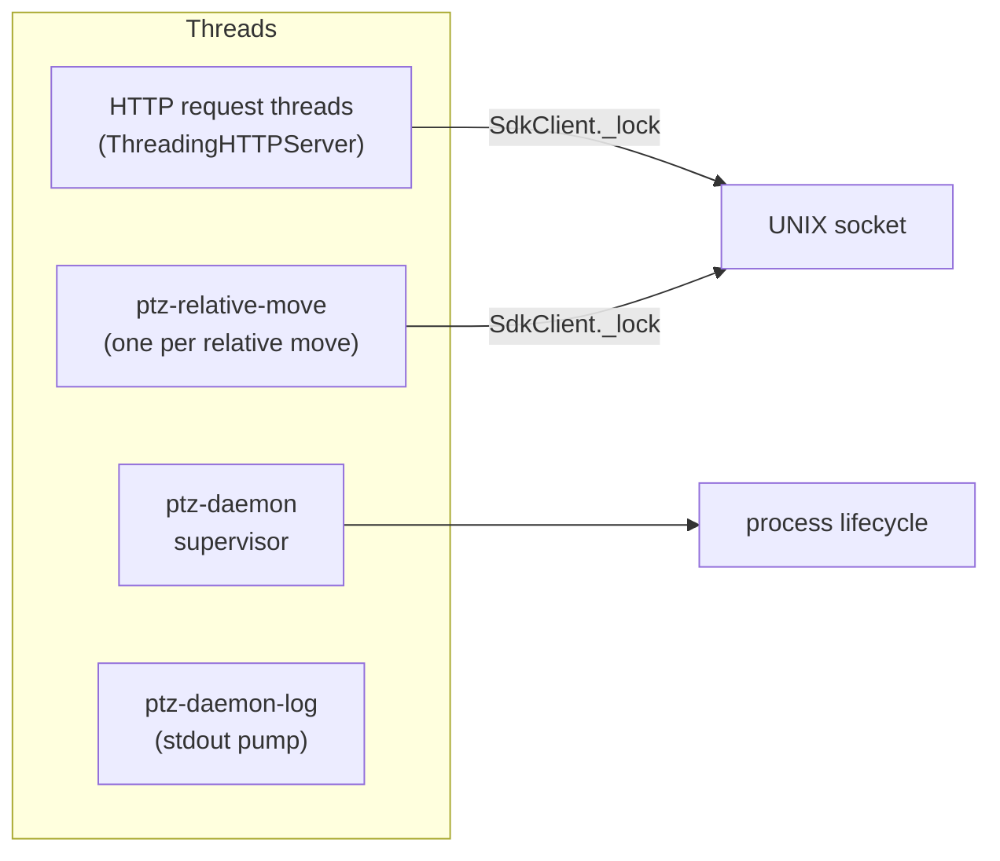

- **HTTP** — one thread per request; handlers may block on the SDK socket.
- **SDK calls** — serialized by `SdkClient._lock`; one connection per command,
  5 s timeout. An empty reply or `ERR` becomes `SdkError`, which surfaces as a
  SOAP fault or a log line.
- **PTZ state** — `PTZController._lock` (RLock) guards `_active`, `_timed` and
  `_cancel`. The timed thread checks ownership before stopping a direction so a
  newer command is never interrupted by an older one.
- **Supervisor** — a dedicated thread loops on `HEALTH_INTERVAL`, checks
  `PING`, and restarts the daemon after three consecutive failures. Spawn
  attempts are retried with exponential backoff, capped at 60 s.
- **Shutdown** — `SIGTERM`/`SIGINT` triggers `server.shutdown()`; `finally`
  stops the daemon (`SIGTERM`, then `SIGKILL` after 5 s) and closes the server.

Failure matrix:

| Failure | Symptom | Behaviour |
| --- | --- | --- |
| Wrong camera credentials | daemon exits with `Login failed 1` | supervisor retries with backoff; `/healthz` 503 while down |
| Camera unreachable | daemon exits with `Login failed 7` | same; the ONVIF server stays up so profiles remain readable |
| Daemon hangs | `PING` times out | after 3 checks it is terminated and restarted |
| ONVIF port busy | startup log warning | server attempts to bind and fails, container restarts |
| Bad SOAP / unknown operation | SOAP fault | request fails; server stays up |
| Camera moves out of range | no detection | open-loop moves have no position feedback |

---

## Security model

- **ONVIF authentication** — WS-Security `UsernameToken`; `PasswordText` or
  `PasswordDigest` (`base64(SHA1(nonce + created + password))`). Comparison is
  constant-time (`hmac.compare_digest`). Missing/invalid credentials return
  `ter:NotAuthorized`.
- **Transport** — plain HTTP inside the LAN; there is no TLS listener. Put the
  bridge on a trusted network or behind a reverse proxy if that matters.
- **Container** — runs as uid 10001 with no shell/home; only the daemon and
  Python app are present.
- **UNIX socket** — `chmod 0666` inside the container, so any process in the
  container can control PTZ; there are no other processes by design.
- **Secrets** — camera credentials and ONVIF credentials come from the
  environment. `.env` is git-ignored and excluded from the Docker build
  context. The camera password is passed as `argv` to the daemon, so it is
  visible in `/proc/<pid>/cmdline` **inside** the container (not from other
  containers).
- **Exposure** — the image bundles the vendor HCNetSDK binaries. Check
  Hikvision's SDK terms before publishing a public image or package.

---

## Deployment topologies

### Compose, one service per camera

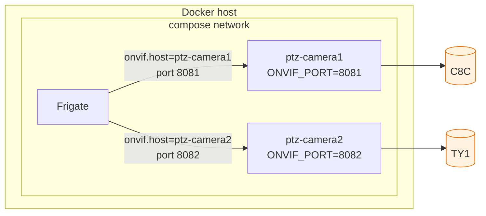

- Default: publish `${ONVIF_PORT}:${ONVIF_PORT}` and point Frigate at the
  Docker host.
- Same compose network: drop `ports`, use the service name and the
  in-container port.
- Host networking: `network_mode: host`, `onvif.host: 127.0.0.1`.
- macOS/Windows: Docker Desktop emulates `linux/amd64` (the vendor SDK is
  x86-64); PTZ traffic is tiny, so the overhead is irrelevant.

### Prebuilt image

GitHub Actions publishes `ghcr.io/mabbas007/ezviz-ptz` (tags `latest`, `main`,
`vX.Y.Z`, `sha-…`). See [README.md](README.md#prebuilt-image-github-container-registry).

### ZoneMinder control module

A second, independent consumer of `ptz_control` — no Python or container
involved:

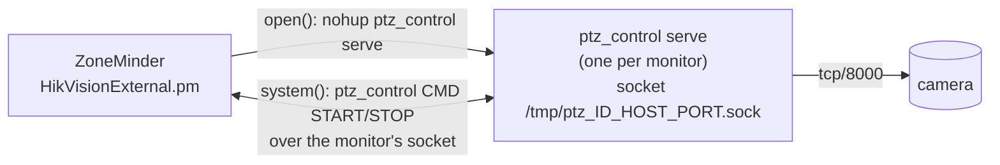

- `ControlAddress` must be `user:password@host:port`.
- `open()` starts a detached daemon with one socket per monitor, `close()`
  sends `SIGTERM`.
- `sendPTZCommand()` invokes the binary's client mode; `moveStop` reuses the
  last direction.

---

## Build, test and release pipeline

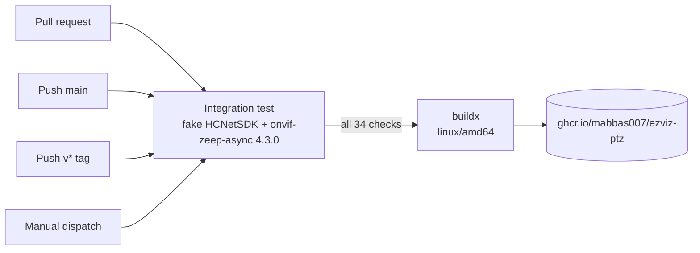

- **Image build** — multi-stage: `gcc:12-bookworm` compiles `ptz_control`
  against `HCNetSDKCom/`; `python:3.12-slim-bookworm` is the runtime, with the
  binary and vendor libs at `/app` so `$ORIGIN/HCNetSDKCom/lib` resolves.
- **Tests** — `frigate-onvif/tests/run.sh` validates the compose file, builds a
  fake HCNetSDK (`LD_PRELOAD`), starts the real image, waits for health, and
  drives it with Frigate's pinned ONVIF client. Covered: discovery via
  `GetServices`, capabilities, profiles, spaces, `MoveStatus`, relative and
  continuous moves, zoom axis, the empty preset list, `AbsoluteMove` fault and
  auth failure.
- **Publish** — only after the test job passes; uses `GITHUB_TOKEN` with
  `packages: write`; tags come from `docker/metadata-action`.

---

## Design decisions and trade-offs

| Decision | Why | Cost |
| --- | --- | --- |
| Drive the camera with HCNetSDK and supply ONVIF ourselves | The cameras have no ONVIF service at all (no HTTP port), and the SDK has no relative-move primitive | Linux x86-64 only; vendor blobs; proprietary protocol |
| One camera per container/process | Frigate's `onvif.host`/`onvif.port` cannot carry a path; isolation of failures and credentials | N ports and N processes for N cameras |
| Emulate relative moves with timed start/stop | The SDK has no relative-move primitive | Open-loop, tuning-dependent, pan and tilt sequential |
| Advertise no absolute or zoom position spaces | Prevents Frigate from using operations the bridge cannot honor | No absolute positioning; Frigate disables zoom autotracking |
| Report no presets instead of storing them | The camera rejects every SDK preset operation (`NET_DVR_NETWORK_ERRORDATA`, all 300 slots) and exposes no ISAPI endpoint, so no implementation can work | Frigate's `return_preset` is unusable; the camera does not return home after tracking |
| Python stdlib HTTP server | Tiny dependency surface and image | No HTTP/2, TLS, or WSDL serving; one SOAP op per POST |
| No WS-Discovery | Frigate uses explicit host/port; discovery adds UDP/broadcast complexity | Discovery-based tools cannot auto-find the bridge |
| Static media profile metadata | Frigate only needs a plausible profile and the PTZ config | `GetStreamUri` is a placeholder unless `RTSP_URL` is set |
| Health = supervisor state | Makes broken camera links visible in `docker ps` | Brief `200` while the daemon is still logging in |

---

## Limitations and roadmap

**Known limitations**

- Single camera per process; no profile-token routing across cameras.
- No absolute PTZ, no zoom position spaces, no relative zoom.
- `GetStatus` position is fixed at `0,0`; no closed-loop correction.
- No WS-Discovery, events, imaging, recordings, snapshots or streaming (except
  the optional `RTSP_URL`).
- Plain HTTP/WS-Security only; no TLS.
- Relative move accuracy depends on manual calibration of
  `PAN_SECONDS_PER_FOV` / `TILT_SECONDS_PER_FOV`.
- `linux/amd64` only; macOS and arm64 hosts need emulation.

**Possible next steps**

1. **Multi-camera mode** — one container exposing one profile per camera;
   Frigate can select a profile with `onvif.profile`. Requires a camera
   registry, per-camera daemon/socket, and token routing in `onvif.py`.
2. **ISAPI backend** — plain HTTP PTZ (`/ISAPI/PTZCtrl/...`) for cameras that
   expose it; would run natively on macOS and arm64. The C8C and TY1 have no
   HTTP port open by default.
3. **WS-Discovery responder** — lets GUI tools and ONVIF scanners find the
   bridge.
4. **Closed-loop moves** — use `POS` plus calibration to correct overshoot.
5. **TLS and per-camera ONVIF credentials** for stricter deployments.

---

## Source map

| Path | Purpose |
| --- | --- |
| `ptz_control.cpp` | SDK daemon and command-line client |
| `HikVisionExternal.pm` | ZoneMinder control module |
| `HCNetSDKCom/` | Vendor headers and shared libraries (Linux x86-64) |
| `frigate-onvif/app/config.py` | Environment configuration |
| `frigate-onvif/app/main.py` | HTTP server, health, signals |
| `frigate-onvif/app/onvif.py` | ONVIF/SOAP implementation |
| `frigate-onvif/app/ptz.py` | Movement state machine |
| `frigate-onvif/app/sdk.py` | Daemon client and supervisor |
| `frigate-onvif/Dockerfile` | Multi-stage amd64 image |
| `frigate-onvif/tests/` | Fake SDK, image test, Frigate-style client |
| `frigate-onvif/tests/fake_hcnetsdk.c` | `LD_PRELOAD` stub of the SDK |
| `docker-compose.yml` | Single-camera deployment |
| `frigate-onvif/docker-compose.example.yml` | Multi-camera / merge example |
| `.env.example` | Documented configuration template |
| `.github/workflows/docker-publish.yml` | Test, build and GHCR publishing |
